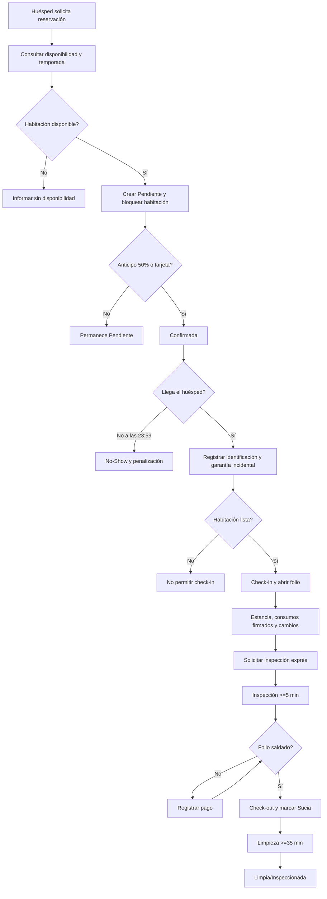

# BPMN - proceso del Hotel Costa Azul

**Fuente original obligatoria:** `docs/references/BPMN_U2_original.pdf` (6 páginas), entregado por el equipo. Esta referencia se conserva sin modificación; es el diagrama visual BPMN que se incluirá en el reporte. El flujo que sigue sirve como apoyo de lectura, **no reemplaza la notación BPMN del original**.

**Excepciones:** avería -> cambio igual/superior sin costo; upgrade -> diferencia prorrateada; mantenimiento -> habitación fuera de inventario; cancelación -> retención/reembolso por 48 h; no-show por 23:59.

**Anotación de alcance:** en el código hay endpoints REST que representan las actividades, pero no hay motor BPMN ejecutable. El profesor solicita diagrama completo y correspondencia, no un motor BPMN.
