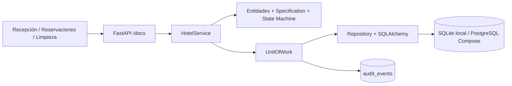
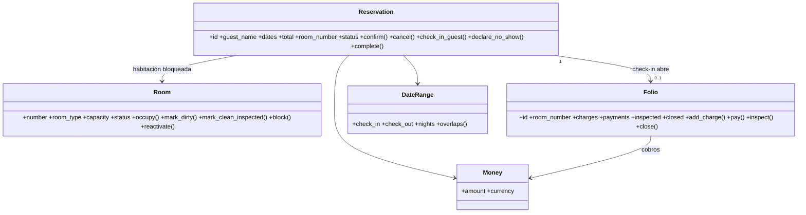
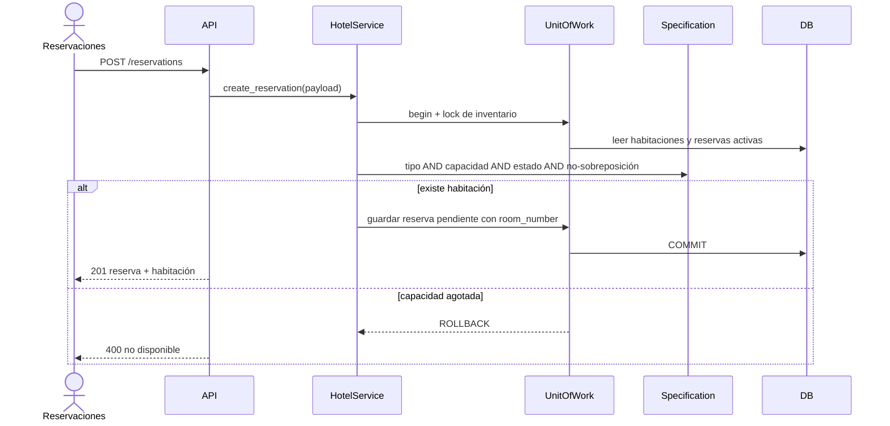

# Arquitectura real implementada - Hotel Costa Azul v2

## Alcance y fuentes
Conserva la continuidad con Unidad 2/3. Ver `docs/references/` y `docs/TRACEABILITY.md`. Arquitectura **monolito modular**, no microservicios. Domain Model permite centralizar reglas temporales y estados del negocio. El sistema no incluye autenticación de usuarios completa ni pasarela bancaria.

## Capas
- `src/domain/hotel.py`: entidades `Room`, `Reservation`, `Folio`; Value Objects `Money`, `DateRange`; políticas `nightly_rate`, `stay_total`; invariantes y reglas.
- `src/domain/specifications.py`: Specification componible, capacidad, categoría, estado, no solapamiento.
- `src/domain/state_machine.py`: transiciones explícitas y restringidas de Reserva y Habitación; invocadas **por las entidades**, no solo definidas.
- `src/application/services.py`: `HotelService` coordina comandos y consultas; transacciones por caso de uso.
- `src/infrastructure/repository.py`: SQLAlchemy, mapeadores, `SQLiteRepository` (nombre histórico: también es PostgreSQL), `UnitOfWork`, persistencia de eventos de auditoría.
- `src/api/main.py`: endpoints FastAPI, validación Pydantic, documentación automática, trabajo periódico no-show.

## Diagrama de componentes

## UML de dominio

## Secuencia - reservar sin sobreventa

## Transiciones reales
Reserva: `Pendiente -> Confirmada -> (Checked-in -> Completada | Cancelada | No-Show)`. `Cancelada` y `No-Show` son terminales. Habitación: `Limpia/Inspeccionada -> Ocupada -> Sucia -> Limpia/Inspeccionada`; `Limpia/Sucia -> Fuera de Servicio -> Sucia` (requiere limpieza antes de liberar). El flujo de cancelación desde Confirmada no está permitido tras check-in.

## Patrones justificables
1. **Domain Model**: evita reglas desperdigadas en endpoints.
2. **Repository y Unit of Work**: mantiene cambio de reserva, habitación, folio y evento en una transacción atómica.
3. **Specification**: criterios combinables; incluye pendientes para bloquear desde solicitud (BR-19).
4. **State Machine**: hace imposible doble confirmación, check-out sin ingreso o cerrar estado terminal.
5. **CQRS ligero**: GET devuelve DTO/proyección; POST ejecuta operaciones de dominio; sin dos bases ni event sourcing.
6. **Audit Log**: persiste eventos técnicos de cada operación; no equivale a event sourcing completo ni a integración de eventos externos.

## SOLID (casos específicos)
- **S**: Room/Reservation/Folio poseen reglas distintas; Servicio coordina; Repository almacena; API traduce HTTP.
- **O**: nuevas Specifications pueden combinarse sin reescribir el motor de selección.
- **L**: dentro del nivel académico, el servicio consume los mismos métodos que ofrece UnitOfWork; aún no hay implementaciones alternativas completas de repositorios.
- **I**: acceso a lectura de `rooms/reservations/folios` separado de escritura contextual; el contrato sigue siendo sencillo, no interfaces formales por agregado.
- **D**: `HotelService` recibe el repositorio por constructor; API compone dependencias mediante `Depends(get_service)`.

## Concurrencia y transacciones
SQLite: `BEGIN IMMEDIATE` serializa escrituras. PostgreSQL: `pg_advisory_xact_lock(90)` serializa escrituras durante cada transacción; reserva también adquiere bloqueo por categoría. Para el volumen de la demostración evita sobreventa multiusuario. Tradeoff: menor concurrencia global; escalar exige bloqueos de menor granularidad o restricciones de exclusión por intervalos.

## Restricciones y riesgos abiertos
- El BRD no fija un plazo para reservas **Pendientes**; esta implementación las bloquea sin vencimiento para cumplir overbooking cero. Se necesita política del hotel para caducidad.
- Semana Santa requiere rangos de fechas confirmados en `HOLY_WEEK_RANGES`; el código no inventa una regla de calendario.
- Los roles requieren token de demostración y las operaciones especiales PIN con hash; no existe un sistema de identidad/usuarios real, ni límite de intentos. No debe usarse como producto público con datos reales.
- Los cobros, reembolsos y liberación de garantía son **simulados**. No hay integración bancaria; nombres de acompañantes solo de prueba, y no guardar números de identificación.
- Reportes son consultas por fecha y reflejan el estado actual de folios; un corte histórico inmutable exige snapshots y política contable adicionales.
- Pruebas SQLite locales no sustituyen comprobar Docker/PostgreSQL, GitHub Actions y el despliegue final.
